> 本文参考[这篇微信公众号文章](https://mp.weixin.qq.com/s?__biz=MzIxODUzNTg2MA==&mid=2247484925&idx=1&sn=f2ff4e9bc8086e82db7f624195606b8b&chksm=97e84726a09fce30b8a09dcb14b4380895ce7248b80dd5e96407d90e3ca94d5fc37cc95e3ec6&scene=21&poc_token=HIaa4WqjmurTTuAJTajTD16NhK0fgEVfbYCeMrMs)，结合自身学习探讨整理。

**先看全貌**，本文的逻辑链条是：词怎么变数字 → 传统序列模型为什么不够用 → Transformer 怎么用「注意力」解决它 → 剩下两大支柱（FFN、残差）→ 最终这些参数怎么落地到硬件。

<!--more-->

## 一、起点：词向量与「没有基准词」的语义空间

神经网络只认识数字，要让机器理解人类语言，第一步必须把词变成向量。

### 1.1 从 One-Hot 到学习型嵌入

**One-Hot 编码（学号法）**：给每个词编一个索引。假设词典有 10 万个词，「苹果」的索引是 4，那它的向量就是 10 万维的 $[0, 0, 0, 1, 0, \dots]$。

**致命缺陷**：极度稀疏、浪费空间，而且毫无语义关联——在这个空间里，「猫」和「狗」的距离，完全等于「猫」和「拖拉机」的距离。

**学习型嵌入（Word Embedding）**：让神经网络去读海量文章自己学。学完之后，「猫」和「狗」的向量在空间中距离非常近，而「猫」和「汽车」相距极远。词的意义，由它与其他词的相对位置决定。

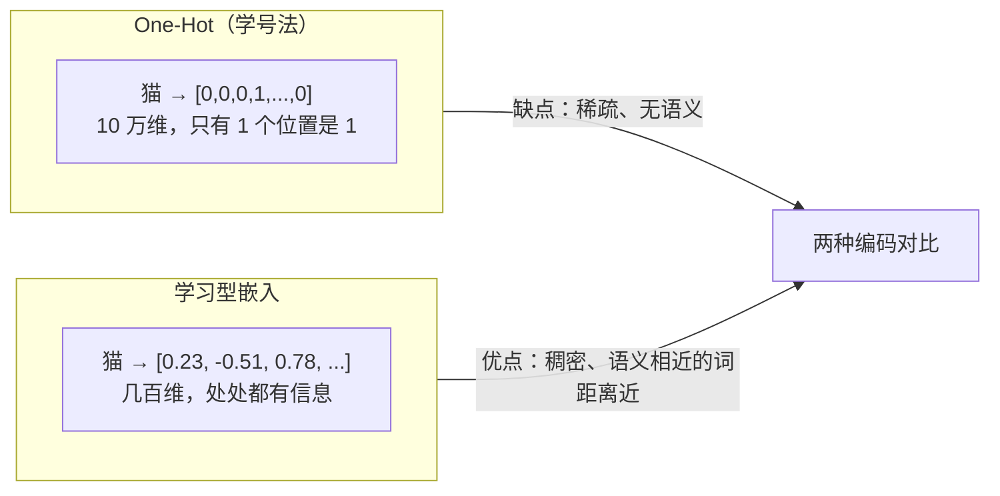

### 1.2 为什么没有「基准词」？

词向量空间是一个**高维的相对空间**，这里不存在绝对的「原点词」。

**相对位移的魔法**：经典例子是 $\text{向量(国王)} - \text{向量(男人)} + \text{向量(女人)} \approx \text{向量(女王)}$。这个公式完全依赖词与词之间的**相对位移**，一旦设了绝对原点，这种相对关系就会被破坏。

**全零向量是什么？** 在数学上零向量没有方向，无法计算余弦相似度。所以在实际工程中，全 0 向量不代表任何真实词，它通常被用作 **Padding（填充符）**，用来对齐句子长度，并在计算时被 Mask 屏蔽掉。

---

## 二、序列模型的困境：Loss、梯度与 RNN

### 2.1 真实答案 $Y_t$ 是怎么来的？

在时间步 $t$，模型输出预测值 $\hat{y}_t$，要计算 Loss 就需要真实标签 $Y_t$。语言模型的 $Y_t$ **不需要人工去标**，它靠的是**自监督学习（下一个词预测）**。

例子：句子「今天 天气 真 不错」。

- 输入 $X_0$ =「今天」，真实答案 $Y_0$ =「天气」；
- 输入 $X_1$ =「天气」，真实答案 $Y_1$ =「真」。

只要把互联网上的文本爬下来，**错位一位**，就能自动获得无数的训练数据。

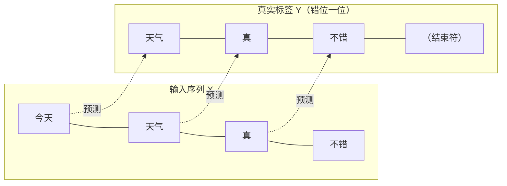

### 2.2 什么是梯度、梯度下降与梯度爆炸/消失？

**梯度**：蒙眼下山时感受到的坡度（方向与陡峭程度）。数学上就是损失函数对参数的导数。

**梯度下降**：顺着坡度的反方向迈一步（更新参数），让 Loss 变小。步长就是「学习率」。

**梯度爆炸**：在 RNN 中，误差需要跨越时间步**连乘**。如果权重稍微大于 1，连乘 50 次后梯度变成天文数字，模型直接崩溃（像下山踩空滚下悬崖）。通常用**梯度裁剪**强行限制梯度最大值。

**梯度消失**：如果权重稍微小于 1，连乘后梯度趋近于 0，模型记不住长距离信息。

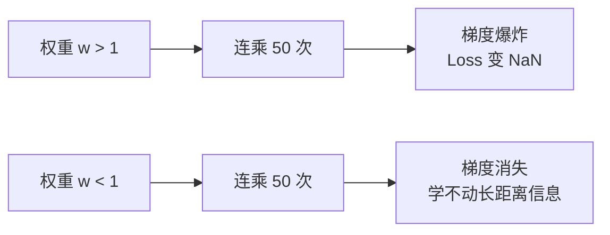

### 2.3 LSTM 的「门控」方案

为了缓解梯度消失，LSTM 在 RNN 里加了三个「保安」（遗忘门、输入门、输出门），并引入一条贯穿始终的「记忆传送带」。它缓解了遗忘，但**依然是串行计算的**（排队一个个进），第 100 个词必须等前 99 个算完，训练极慢。

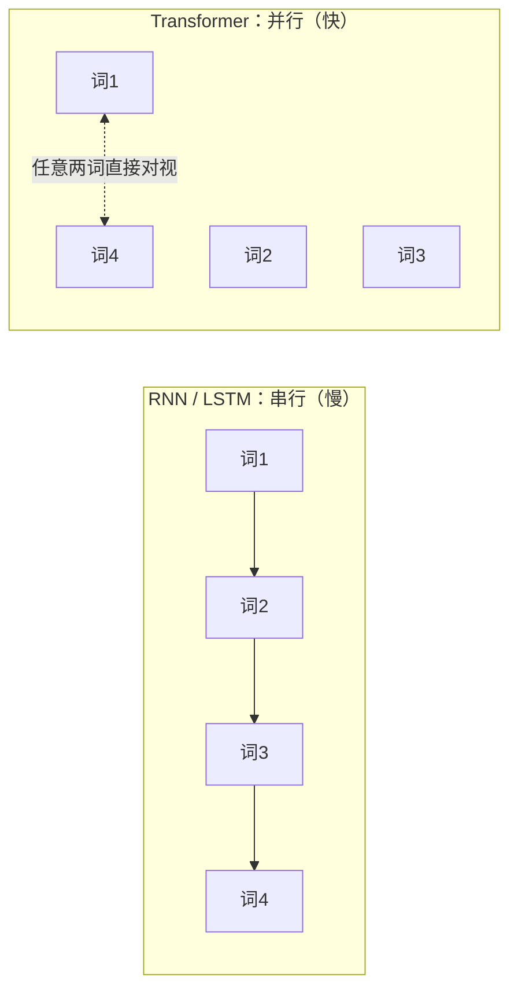

> 这张图是后面所有内容的核心动机：**串行太慢**，所以人们想要一个「所有词能同时看到彼此」的结构——这就是自注意力。

---

## 三、Transformer 的核心：自注意力机制（Self-Attention）

### 3.1 用「YouTube 搜索」理解 Q、K、V

自注意力本质上是**高级的字典搜索**。

- **Q（Query 查询）**：你在搜索框输入的「深度学习」。代表「我需要什么」。
- **K（Key 键）**：视频库里的标题（如「深度学习入门」「科比集锦」）。代表「我有什么特征」。
- **V（Value 值）**：视频的真实画面和内容。代表「如果你选中我，我提供什么信息」。

操作过程：系统拿 Q 去和所有 K 比对，算出相关性分数。搜索引擎会把分数最高的那**一个**视频（V）直接展示给你；但自注意力不这么干。

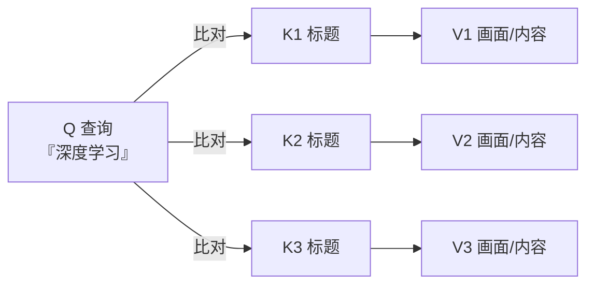

### 3.2 自注意力：从「点菜」到「榨果汁」

例子：句子「苹果公司发布了新手机，它的市值大涨。」

这里的「市值」作为 Q，去和所有词比对。算出权重：「苹果」占 0.7、「公司」占 0.2、「手机」占 0.1。

- **如果只挑最大值（点菜）**：「市值」的新向量完全等于「苹果」的向量，丢失了「公司」和「手机」的语境。
- **自注意力的做法（榨果汁）**：把「苹果」的 V 乘 0.7、「公司」的 V 乘 0.2、「手机」的 V 乘 0.1，然后全部加总混合，榨出一杯「混合果汁」。

这杯果汁，就是一个包含了全句上下文的、全新的「市值」特征向量。它**不是某一个词，而是一个数学上的超级综合体**。

### 3.3 具体计算四步曲

1. **投影**：用三个不同的矩阵，把输入词变成 Q、K、V。
2. **点积打分**：$Q \times K^T$，计算词与词之间的相似度（点积越大，方向越一致）。
3. **Softmax 归一化**：把分数变成 0 到 1 的百分比（注意力权重）。
4. **加权求和**：权重矩阵 $\times$ V 矩阵，得到融合了全局信息的新向量。

> **两个补充细节**（原文没提，但很重要）：
> 1. 实际工程里点积后还要**除以 $\sqrt{d}$**（$d$ 是向量维度），防止向量太长时点积数值过大、Softmax 之后梯度变得极平。
> 2. Softmax 的作用就是**把分数变成概率分布**，保证所有权重加起来等于 1。

### 3.4 多头注意力（Multi-Head Attention）

就像漫威粉看「钢铁侠」海报，单次注意力只能看一个维度。多头注意力就是派 8 个、16 个人同时看：

- 头 1 盯钢铁侠本体；
- 头 2 盯背景的飞船；
- 头 3 盯脚下的建筑物。

最后拼起来，模型对画面的理解就非常立体。

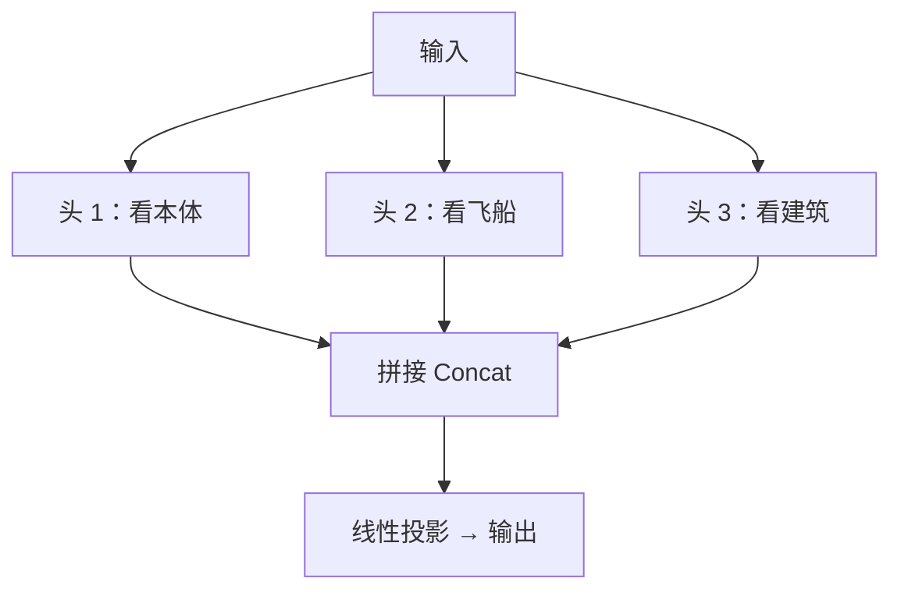

### 3.5 补一个关键衔接：位置编码

自注意力「任意两个词距离都是 1」既是它的优点，也带来一个问题——**它天生不知道词的顺序**：「我爱你」和「你爱我」在注意力眼里会得到完全一样的打分。

所以 Transformer 在词向量进模型之前，会先**加上位置编码（座位号）**，告诉模型每个词排在第几位。这就是第六节里「给每个词发座位号」的由来。

---

## 四、Transformer 的另外两大支柱：FFN 与残差连接

### 4.1 FFN：大模型里的「百科全书」

自注意力负责「开会交流」（找关系），FFN 负责让每个词「闭门查资料」（调取知识）。**大模型 2/3 的参数都在这里。**

**它是怎么死记硬背的？（神经元例子）**

假设 520 号神经元专门记「法国首都是巴黎」：

- **第一层（匹配）**：当输入是「法国首都」时，点积算出来是大正数（如 85 分）；输入是「中国首都」时，算出来是负数（如 −12 分）。
- **激活函数（过滤）**：负数全变 0（闭嘴），正数保留（激活）。
- **第二层（输出）**：520 号神经元被激活后，通过第二层权重，把「巴黎」的语义输出出来。

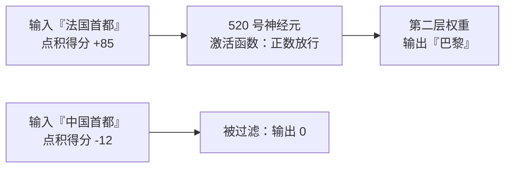

**为什么会产生「幻觉」？**

如果问「张三的妈妈的舅舅是谁」，模型的高维格子里没存过这个知识。但相关神经元还是被激活了，它只能顺着权重，**强行拼凑出一个语法完美但内容虚假的答案**。

### 4.2 残差连接：信息的高速公路

公式：$\text{输出} = x + F(x)$（$x$ 是输入，$F(x)$ 是该层算出来的结果）。

它就像在每一层旁边修了条直达高速。不管中间层怎么瞎折腾，原始信息 $x$ 都能直接传到下一层。这让 Transformer 即使堆叠上百层，梯度也不会消失，网络也不会退化。

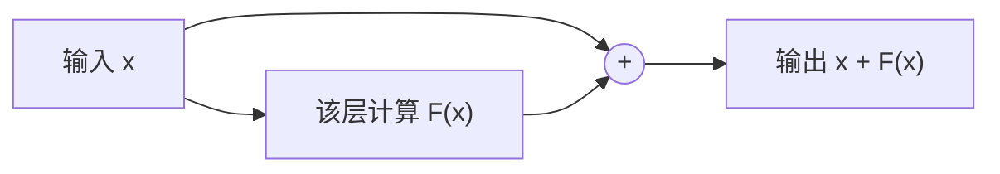

---

## 五、长上下文与参数量：硬件与物理部署

### 5.1 为什么长文本不怕忘，却怕显卡爆炸？

自注意力让任意两个词距离都是 1，所以记忆力极强。但它的复杂度是 $O(N^2)$。文本长度翻倍，算力和显存消耗翻 **4 倍**。

现在的 100 万长上下文，靠的是 **FlashAttention 算法**（优化显存读写）和**稀疏注意力**（只让局部或特定的词对视），强行给显卡续命。

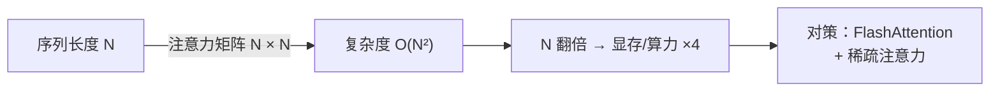

### 5.2 几十亿个权重，平时存在哪？

- **平时（仓库）**：躺在硬盘里，是个上百 GB 的 `.safetensors` 静态文件（如 70B 模型约 140 GB）。
- **运行时（工作台）**：当你提问时，权重瞬间被搬进 GPU 的**显存（VRAM）**里。如果显存装不下，工程师就会用**量化技术**（把 FP16 压缩成 INT8/INT4），就像把百科全书里的字变小，让模型能塞进显卡里。

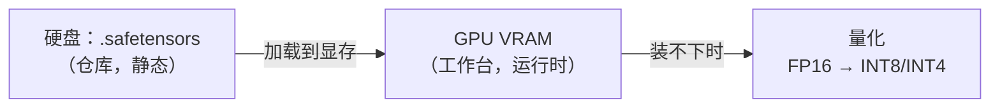

---

## 六、终极总结：数据在 Transformer 里的奇幻漂流

数据进入大模型后，会在几十层相同的「模块（Block）」里循环升级。单个 Block 的完整结构如下：

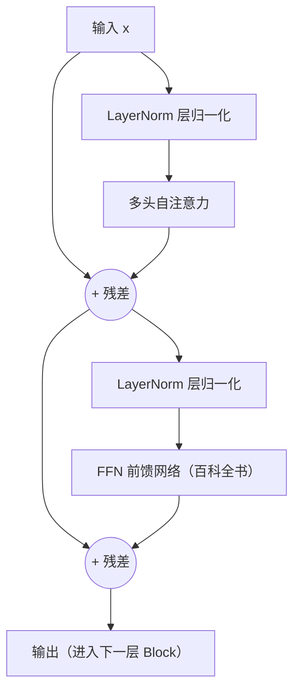

逐环节来看这段「漂流」：

1. **位置编码**：给每个词发「座位号」，让它们同时进场不乱套。
2. **自注意力**：词与词开会交流，弄清指代关系和上下文。
3. **残差连接**：加上捷径，确保信息无损传递。
4. **FFN**：每个人回座位翻开「百科全书」提取知识。
5. **残差连接**：再次加上捷径，维持稳定。

**一句话总结三大支柱**：

- 自注意力负责「**关系**」，
- FFN 负责「**知识**」，
- 残差连接负责「**稳定**」。

这就是支撑 ChatGPT、Claude 等所有现代大语言模型的底层骨架。
